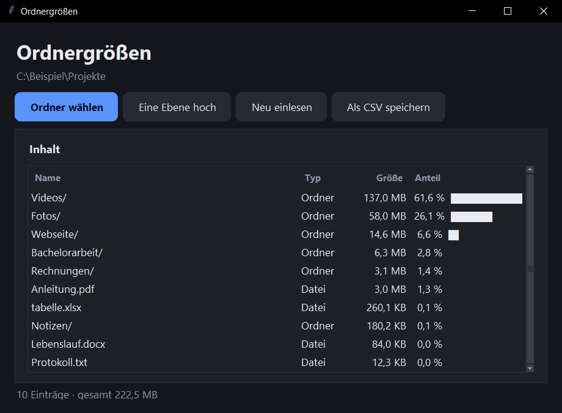
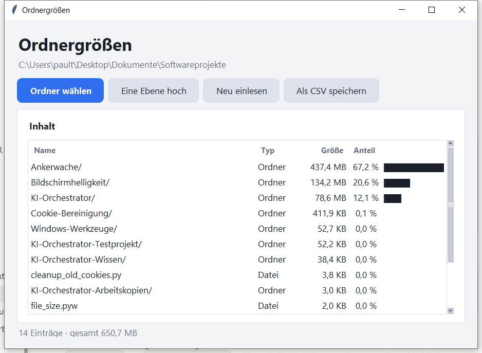
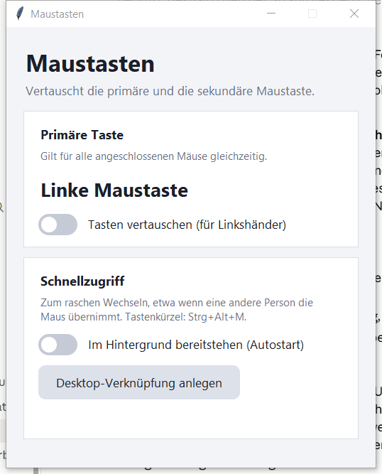

# Windows-Werkzeuge

Zwei kleine, eigenständige Werkzeuge für Windows mit einheitlicher Oberfläche (hell/dunkel nach Systemeinstellung, hochauflösend, ohne Fremdabhängigkeiten):

- **Ordnergrößen** – zeigt, welche Dateien und Unterordner den meisten Speicher belegen.
- **Maustasten** – vertauscht primäre und sekundäre Maustaste, per Fenster oder Kommandozeile.



## Voraussetzungen

**Ohne Installation:** `Ordnergroessen.exe` und `Maustasten.exe` aus den [Releases](https://github.com/paul-teumer/Windows-Werkzeuge/releases) laden und starten – weder Python noch weitere Pakete sind nötig. Die Kommandozeilen-Schalter der Maustasten gelten ebenso für die `.exe`.

**Aus dem Quelltext:** Windows 10/11 und Python 3.10 oder neuer (nur Standardbibliothek).

```
git clone https://github.com/paul-teumer/Windows-Werkzeuge.git
cd Windows-Werkzeuge
```

## Ordnergrößen

```
pythonw ordnergroessen.pyw
```

- Größen werden im Hintergrund ermittelt und erscheinen, sobald sie feststehen.
- Sortierung per Klick auf die Spaltenköpfe; Doppelklick auf einen Ordner öffnet diesen.
- Verknüpfungen und Junctions werden nicht verfolgt, nicht lesbare Pfade übersprungen.
- Export der Ansicht als CSV (Semikolon, UTF-8 mit BOM, Größe in Bytes) für Excel.



## Maustasten

Windows 11 bietet keine bequeme Möglichkeit mehr, die Maustasten zu vertauschen – erst recht nicht, wenn zwei Mäuse im Wechsel von einer rechts- und einer linkshändigen Person benutzt werden. Dieses Werkzeug schaltet in einem Schritt um. Die Einstellung gilt systemweit für alle angeschlossenen Mäuse.

```
pythonw maustasten_tausch.pyw
```

Schnellzugriff ohne Fenster:

- **Tastenkürzel Strg+Alt+M** und Symbol im Infobereich der Taskleiste (Klick schaltet um, Rechtsklick öffnet das Menü). Das Symbol zeigt die aktuell primäre Taste; der Hintergrundbetrieb lässt sich im Fenster einschalten und startet dann mit Windows.
- **Desktop-Verknüpfung**, die per Doppelklick umschaltet; im Fenster per Knopf angelegt.
- Kommandozeile:

```
python -m werkzeuge.maustasten --wechseln     # Zustand umschalten
python -m werkzeuge.maustasten --links        # linke Taste primär
python -m werkzeuge.maustasten --rechts       # rechte Taste primär
python -m werkzeuge.maustasten --status
python -m werkzeuge.maustasten --hintergrund  # Symbol und Tastenkürzel ohne Fenster
```

Die Umstellung erfolgt über die Windows-Schnittstelle `SystemParametersInfo`; sie wirkt sofort, ohne Registry-Eingriff und ohne Neuanmeldung, und bleibt dauerhaft erhalten.



## Tests

```
python -m unittest discover -s tests -t .
python erstellen.py   # baut die beiden .exe-Dateien (benötigt PyInstaller)
```

## Lizenz

Copyright © 2026 Paul Teumer. Lizenziert unter der [GNU General Public License v3.0](LICENSE).
